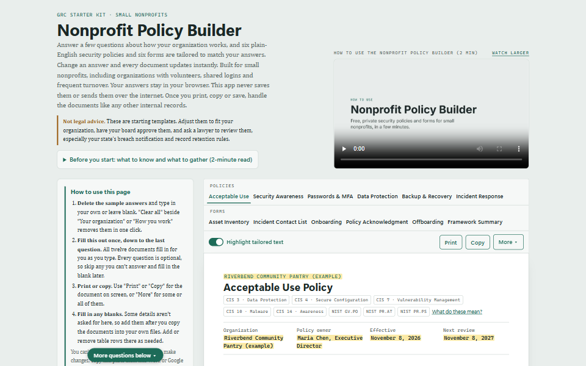
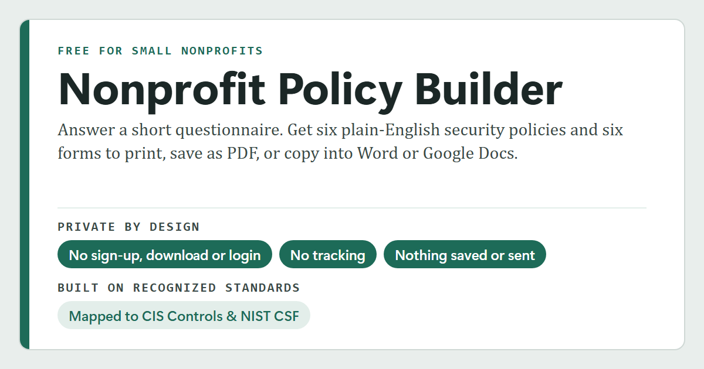

# Nonprofit Policy Builder

**Plain-English security policies for any small nonprofit, including volunteer-run teams, tailored in about 15 minutes, free, and with nothing you type ever leaving your browser.**

**Live site:** https://policies-for-small-nonprofits.netlify.app (coming soon) · **Version:** 1.0.0 · **[Download the app](#download-the-app)** · **Report a problem:** [Issues](../../issues) · **Report a security problem:** [SECURITY.md](SECURITY.md)

> **Not legal advice.** These are starting templates for discussion. Have your board approve them, and ask a lawyer to check your state's breach notification and record retention rules.

<a href="assets/app-full-page.png"></a>

*The app with its sample answers. Click the picture to see the whole page.*

## Why it exists

Small nonprofits hold sensitive information: donor names, home addresses, giving history, payment details and records about the people they serve. Most have no IT staff. Work is done by part-time staff and volunteers on their own phones and laptops, logins for social media and event accounts are shared, and people come and go every few months.

Security policy templates online are usually written for corporations, with an IT department, company devices and stable staff. Small nonprofits either skip policies or adopt documents that don't match how they work, so nobody follows them. This app writes policies for how small nonprofits actually operate.

## What it does

A nonprofit answers a short questionnaire about its organization, the systems it uses and how it works. Six policies, an Incident Contact List, onboarding and offboarding checklists, a Policy Acknowledgment Form, an Asset Inventory and a Framework Summary update instantly as answers change:

| Document | What it covers |
|---|---|
| **Acceptable Use** | How people may use the organization's accounts, devices and information, including approved software and online services, device setup, office Wi-Fi, personal devices, AI tools, reporting problems and what happens if it isn't followed |
| **Passwords & MFA** | Passphrases, a password manager instead of the browser, MFA on key accounts, shared-account rules, two or three admins, giving and removing access, turning off unused accounts |
| **Data Protection** | Classifying, storing, sharing and destroying information about donors, the people served, staff and volunteers, including card payments, consent for client photos and stories, and donor privacy requests |
| **Backup & Recovery** | Who it covers, what gets backed up, the 3-2-1 rule, how backups run with or without a backup service, how long backups are kept, protecting backups, testing restores, who is responsible and step-by-step recovery after an incident |
| **Incident Response Plan** | A short, step-by-step plan for what to do when something goes wrong |
| **Security Awareness and Training** | When people are trained, what training covers, who runs it, training deadlines, third parties, how it is recorded and how long records are kept, and the yearly review and summary to the board |
| **Incident Contact List** | A confidential two-page list of who to call (print it double-sided), kept separate from the plan and checked every three months. It fills in the primary IT contact, the alternate incident contact and the board chair from your answers |
| **Onboarding** | A one-page checklist for giving access when someone joins, with a record of the access given |
| **Offboarding** | A one-page checklist for removing access when someone leaves |
| **Policy Acknowledgment Form** | A one-page form where each person initials the policies they received and signs |
| **Asset Inventory** | A one-page landscape form listing every account, service, shared account and device, including whether each device belongs to the organization or a person, reviewed every six months |
| **Framework Summary** | A one-page list of each document's CIS and NIST labels with a plain-English key and where to read each framework, for board packets and records |

**Tailoring.** Answers change the policy text itself, not just names. Groups with no paid staff get wording that fits a volunteer-run team, groups with no organization-owned devices lose the device rules and Devices table, personal devices add rules for using them and an "Organization or personal?" column in the Asset Inventory, an office with Wi-Fi adds router and guest network rules, an office server or storage device adds rules for protecting it and backing it up off-site, shared logins add shared-account rules and a Shared accounts table in the Asset Inventory, high turnover means same-day access removal, cyber insurance means calling the insurer first, and so on. A "Highlight tailored text" switch marks every sentence that changed because of an answer, and every answer you typed in, such as names and phone numbers.

**Getting the policies out:**
- Copy one document, or any combination, into Word or Google Docs with headings and tables intact. Add table rows there if you need more.
- Print them in a separate tab, so your answers aren't lost. The Incident Contact List takes two pages, so print it double-sided.
- Save as PDF from the print dialog.

**Nonprofit-specific content** that corporate templates usually miss: gift-card and bank-change scams that impersonate the executive director, the 501(c)(3) limit on political activity, view-only, time-limited volunteer access, board members kept in scope, calling the cyber insurer before outside help, and reporting to the FBI (ic3.gov) and CISA.

## Framework mappings

Every document is mapped to the **CIS Critical Security Controls v8.1, Implementation Group 1** and the **NIST Cybersecurity Framework 2.0**, and shows its mappings as labels.

| Document | CIS Controls v8.1 | NIST CSF 2.0 |
|---|---|---|
| Acceptable Use | 3 Data Protection · 4 Secure Configuration · 7 Continuous Vulnerability Management · 10 Malware Defenses · 14 Security Awareness | GV.PO · PR.AT · PR.PS |
| Passwords & MFA | 5 Account Management · 6 Access Control Management | PR.AA |
| Data Protection | 3 Data Protection · 15 Service Provider Management | PR.DS · ID.AM |
| Backup & Recovery | 11 Data Recovery | PR.DS · RC.RP |
| Incident Response Plan | 17 Incident Response Management | RS · RC |
| Incident Contact List | 17 Incident Response Management (17.2) | RS.CO |
| Onboarding | 5 Account Management · 6 Access Control Management | PR.AA |
| Offboarding | 5 Account Management · 6 Access Control Management | PR.AA |
| Policy Acknowledgment Form | 14 Security Awareness | GV.PO · PR.AT |
| Asset Inventory | 1 Enterprise Assets · 2 Software Assets · 15 Service Provider Management | ID.AM |
| Security Awareness and Training | 14 Security Awareness | PR.AT · GV.RR |

The mappings show alignment, not certification. The policy wording and mappings are reviewed once a year, and the app shows the date of the last review. When CIS or NIST publishes a new version, the mappings are updated by hand and reviewed by a person. The app never fetches framework data.

## Privacy

- **Nothing is saved.** Answers live only in the open browser tab: no cookies, no local storage, no database. Closing or refreshing the tab erases them, and the browser asks you to confirm first.
- **Nothing is sent.** No server, accounts or logins. The app makes no network calls and loads no outside fonts, analytics or trackers.
- **After you print, copy or save, your devices take over.** This app can’t protect documents after they leave this page. Print and save only on a trusted network, such as your organization’s network or a secured home network, not public Wi-Fi. Use a printer and storage you trust. Shared printers and folders that copy to the cloud, like OneDrive, Google Drive or Dropbox, may keep a copy. Pick up printouts right away, and save only to your organization’s account, not a personal one. Treat these documents like any other internal record.
- **You can check this yourself.** Open the browser's developer tools and watch the Network tab while filling in the form. No requests appear.

Like every website, the host that delivers the page sees visitors' IP addresses. It never receives anything typed into the app.

## Sharing, search engines and AI crawlers

### Share previews (Open Graph)

When someone shares the site's link on LinkedIn, Facebook, Microsoft Teams, Slack, Discord or a messaging app, that app builds a preview card from Open Graph tags in each page's `<head>`. Both pages (`index.html` and `how.html`) have their own title, description and picture tags, plus a plain `meta name="description"` for search results.



- **The picture** (`app/og-image.png`, 1200 × 630) was made for this project in the app's own colors. On the left: "Free for small nonprofits", the name, "Security policies and forms, tailored to your answers.", then, under a thin line, a checklist with green check marks: No sign-up or login · Nothing saved or sent online · Mapped to CIS & NIST CSF ("mapped to", not certified). On the right: a tilted view of the sample Acceptable Use Policy with its tailored text highlighted.
- **The title and description** repeat the privacy points, because some apps show a small picture or none.
- **Privacy:** visitors' browsers ignore the tags. They load nothing and share nothing about the visitor. Only the app building the preview reads them, and it sees just the page with sample answers.
- **Full addresses:** `og:url` and `og:image` need the site's full address, so they use https://policies-for-small-nonprofits.netlify.app.

### Search engines and AI crawlers

- **`robots.txt`** lets search engines and AI search tools list the site, and asks AI training crawlers (such as GPTBot, ClaudeBot, Google-Extended and CCBot) not to copy it. It is a request, not a security control, and it lists no private paths, because the site has none. The crawlers that build share previews are allowed.
- **`sitemap.xml`** lists the site's two pages for search engines and is linked from the footer. `robots.txt` points to it with a `Sitemap:` line.

## Security

The app is a security tool, so it follows the practices it recommends:

- **Output escaping:** everything typed is shown as plain text and can never run as code.
- **Strict Content Security Policy** (`app/_headers`): only the site's own script files run. Inline and injected scripts are refused, outgoing connections and form submissions are blocked, and the app can't be embedded in another site.
- **No third-party code:** no outside scripts, fonts or libraries, so there's no supply chain to tamper with.
- **Other headers:** HSTS, `nosniff`, `Referrer-Policy: no-referrer` and a restrictive `Permissions-Policy`.

**Testing** (header and HTTPS scans, OWASP ZAP, Semgrep, and manual script-injection tests on every text field) is planned before launch. Results will be summarized here and on the app's help page.

**Found a problem?** Please report it privately. See [SECURITY.md](SECURITY.md).

## Using the app

1. Open the live site (https://policies-for-small-nonprofits.netlify.app). No sign-up, download or login.
2. Watch the two-minute walkthrough video at the top of the page, then open **Before you start** to see what information to gather first.
3. Replace the example organization's answers with your own. **Clear all** beside "Your organization" or "How you work" removes the sample answers in that section in one click. Every question is optional; anything left blank shows as a dash or a line to fill in later. Pin the tab so it's harder to close by accident.
4. Review each document, then copy or print them, and finish in one sitting. If a document still has a sample answer in it, the app lists those answers first, so you can change them or carry on anyway.
5. Edit the documents in Word or Google Docs, have your board approve them, and share them with your team. Keep the Incident Contact List confidential.

## Download the app

You can keep your own copy of the app on your computer. It's free, needs no installation and works without an internet connection. Use this if your organization doesn't allow staff to use websites or online tools for this kind of work.

1. Go to the [latest release](../../releases/latest).
2. Under **Assets**, download **`nonprofit-policy-builder-<version>.zip`** (for example, `nonprofit-policy-builder-1.0.0.zip`). It holds only the app, plus the LICENSE and NOTICE files. You don't need the **Source code** files that GitHub adds to every release.
3. Unzip the file.
4. Open the `app` folder and double-click `index.html`. The app opens in your browser.

**Optional: check the download.** Each release lists the zip's SHA-256 hash. If your copy's hash matches, the file hasn't been changed. On Windows, run `certutil -hashfile nonprofit-policy-builder-1.0.0.zip SHA256` in Command Prompt; on a Mac, run `shasum -a 256 nonprofit-policy-builder-1.0.0.zip` in Terminal.

A downloaded copy doesn't update itself. To check for a newer version, compare the version number in the app's footer with the [latest release](../../releases/latest).

Your answers are not saved in a downloaded copy either, so finish in one sitting. The site's security settings don't apply to a copy on your computer, because they are sent by the web host. The app still never saves your answers or sends them over the internet.

## Running it locally

The app needs no build step and no server.

- **Quickest:** open `app/index.html` in a browser.
- **Closer to the live site:** serve the folder locally, then open http://localhost:8000:
  ```
  cd app
  python -m http.server 8000
  ```

The security headers in `app/_headers` are sent by Netlify, so they only apply on the live site. A local copy still never saves your answers or sends them over the internet.

## Deploying

Upload the **whole `app` folder** to Netlify, either by drag-and-drop or with `netlify deploy --prod`. It contains only the files the site needs. Keep the `_headers` file name exactly as it is, with no file extension. After deploying, re-test the live site. Netlify's deploy history allows an instant rollback.

**The site's address** (https://policies-for-small-nonprofits.netlify.app) is written into `index.html` and `how.html` (the Open Graph tags), `sitemap.xml` and the `Sitemap:` line in `robots.txt`. If the address ever changes, update all four. After deploying, check the share preview with LinkedIn Post Inspector and Facebook's Sharing Debugger, which also refresh old previews.

## Project structure

```
app/                  Everything the live site needs. Deploy this folder only.
  index.html          The page and its styles (no JavaScript inside)
  app.js              All of the app's logic
  frameworks.js       CIS and NIST version names, shared by both pages
  how.html            Help page: framework mappings, privacy, printing and security
  _headers            Netlify security headers (keep this exact name)
  robots.txt          Lets search engines list the site; asks AI training crawlers to stay out
  sitemap.xml         Lists the site's two pages for search engines (linked in the footer)
  og-image.png        Preview picture shown when the site is shared on LinkedIn, Teams, Slack and similar
  Nonprofit_Policy_Builder_Walkthrough.mp4   Two-minute video on how to use the page
  walkthrough-poster.jpg                     Still image shown on the video before it plays
.github/ISSUE_TEMPLATE/problem-report.md   Form for reporting a problem on GitHub
coming-soon/          One-page "Coming soon" placeholder with its own security headers (not part of the app)
assets/               Screenshots of the app (shown at the top of this file)
LICENSE               Who may use the software and how
NOTICE                Third-party, framework and legal notices
README.md             This file
SECURITY.md           How to report a security problem
CLAUDE.md             Standing rules for Claude Code when working on this project
```

Only `app/` is deployed. Everything else stays in the repository.

## How it was built

The Nonprofit Policy Builder was conceived, designed, and developed by the creator as a GRC internship project to help small nonprofits build practical cybersecurity policies aligned with recognized security frameworks. The creator defined the application's purpose, scope, user experience, questionnaire flow, policy architecture, framework mappings, security requirements, and overall content strategy.

**Claude Code**, Anthropic's AI coding assistant, was used as a development tool to help implement the application. It assisted with coding tasks, drafting policy language, generating policy templates, refining tailoring logic, reviewing code, and identifying potential issues.

[`CLAUDE.md`](CLAUDE.md) provides standing instructions for the AI assistant, including security requirements such as escaping all input, avoiding inline scripts, and never loading external resources. These guardrails help maintain the application's security design during future development.

AI-generated code and content were treated as drafts. The creator reviewed, edited, tested, and approved all code, policy content, framework mappings, and security controls before deployment. Final decisions regarding application design, policy content, nonprofit use cases, framework alignment, and security requirements were made by the creator.

## Tools used

- **Visual Studio Code:** code editor.
- **Claude Code CLI:** AI coding assistant used in the terminal to help write and review the code and draft content.
- **Claude desktop app:** used to make the share preview picture (`app/og-image.png`).
- **Piper TTS (voice: en_US-lessac-medium):** text-to-speech voice for the walkthrough video's narration, licensed for non-commercial use only. See [NOTICE](NOTICE).

## Limitations

- The policies are templates, not legal advice.
- A policy only works if people know about it and follow it. The app doesn't provide training or track acknowledgments.
- Industry-specific rules such as HIPAA and FERPA are not covered.
- The framework mappings show alignment, not compliance or certification.

## License

**Proprietary Software - All Rights Reserved**

This software is made available for free use by nonprofit organizations for internal purposes. Modification, creation of derivative works, redistribution, rebranding, incorporation into other products, and commercial use are prohibited without prior written permission from SBecraft.

The full terms, including what you may do with the documents the app generates, are in the [Nonprofit Policy Builder License](LICENSE). See also [NOTICE](NOTICE).

Nonprofit Policy Builder © 2026 SBecraft · Free for nonprofits to use · Not legal advice
