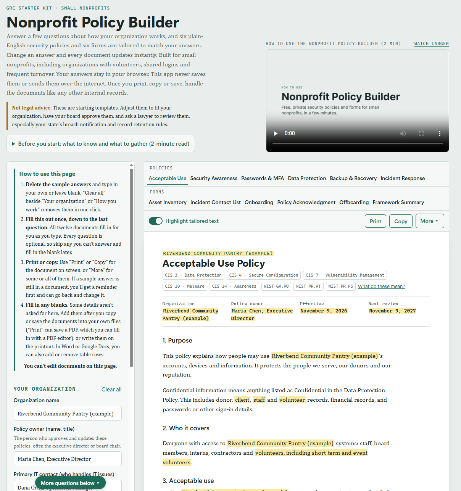

# Nonprofit Policy Builder

**Plain-English security policies, tailored in about 15 minutes, free, and with nothing you type ever leaving your browser. Built for small nonprofits, including organizations with volunteers, shared logins and frequent turnover.**

<table>
  <tr>
    <td><strong>Live site</strong></td>
    <td><a href="https://nonprofit-policy-builder.pages.dev">nonprofit-policy-builder.pages.dev</a></td>
    <td rowspan="4" valign="middle" align="center"><a href="#terms-of-use">Terms of Use</a></td>
  </tr>
  <tr><td><strong>Version</strong></td><td>1.0.0</td></tr>
  <tr><td><strong>Download</strong></td><td><a href="#download-the-app">Get the app</a></td></tr>
  <tr><td><strong>Report</strong></td><td><a href="../../issues">A problem</a> · <a href="SECURITY.md">A security flaw in the app</a></td></tr>
</table>

> **Not legal advice.** These are starting templates for discussion. Have your board approve them, and ask a lawyer to check your state's breach notification and record retention rules.

<table>
  <tr>
    <td valign="middle"><a href="assets/app-full-page.png"></a></td>
    <td valign="middle" align="center"><em>The app with its sample answers.</em><br><br><em>Click the picture to see the whole page.</em></td>
  </tr>
</table>

---

<a id="contents"></a>**Contents:** [Why it exists](#why-it-exists) · [What it does](#what-it-does) · [Works on any device](#works-on-any-device) · [Framework mappings](#framework-mappings) · [Privacy](#privacy) · [Search engines and AI crawlers](#search-engines-and-ai-crawlers) · [Security](#security) · [Using the app](#using-the-app) · [Download the app](#download-the-app) · [Running it locally](#running-it-locally) · [Project structure](#project-structure) · [How it was built](#how-it-was-built) · [Tools used](#tools-used) · [Limitations](#limitations) · [Terms of Use](#terms-of-use) · [License](#license)

---

## Why it exists

Small nonprofits hold sensitive information: donor names, home addresses, giving history, payment details and records about the people they serve. Most have no IT staff. Work is done by part-time staff and volunteers on their own phones and laptops, logins for social media and event accounts are shared, and people come and go every few months.

Security policy templates online are usually written for corporations, with an IT department, company devices and stable staff. Small nonprofits either skip policies or adopt documents that don't match how they work, so nobody follows them. This app writes policies for how small nonprofits actually operate.

## What it does

A nonprofit answers a short questionnaire about its organization, the systems it uses and how it works. Six policies and six forms update instantly as answers change. They are listed in the same order as the app's tabs.

**The six policies**

| Policy | What it covers |
|---|---|
| **Acceptable Use** | How people may use the organization's accounts, devices and information, including approved software and online services, device setup, office Wi-Fi, personal devices, AI tools, reporting problems and what happens if it isn't followed |
| **Security Awareness and Training** | When people are trained, what training covers, who runs it, training deadlines, third parties, how it is recorded and how long records are kept, and the yearly review and summary to the board |
| **Passwords & MFA** | Passphrases, a password manager instead of the browser, MFA on key accounts, shared-account rules, two or three admins, giving and removing access, turning off unused accounts |
| **Data Protection** | Classifying, storing, sharing and destroying information about donors, the people served, staff and volunteers, including card payments, consent for client photos and stories, and donor privacy requests |
| **Backup & Recovery** | Who it covers, what gets backed up, the 3-2-1 rule, how backups run with or without a backup service, how long backups are kept, protecting backups, testing restores, who is responsible and step-by-step recovery after an incident |
| **Incident Response Plan** | A short, step-by-step plan for what to do when something goes wrong |

**The six forms**

| Form | What it covers |
|---|---|
| **Asset Inventory** | A one-page landscape form listing every account, service, shared account and device, including whether each device belongs to the organization or a person, reviewed every six months |
| **Incident Contact List** | A confidential two-page list of who to call (print it double-sided), kept separate from the plan and checked every three months. It fills in the primary IT contact, the alternate incident contact and the board chair from your answers |
| **Onboarding Checklist** | A one-page checklist for giving access when someone joins, with a record of the access given |
| **Policy Acknowledgment Form** | A one-page form where each person initials the policies they received and signs |
| **Offboarding Checklist** | A one-page checklist for removing access when someone leaves |
| **Framework Summary** | A one-page list of each document's CIS and NIST labels with a plain-English key and where to read each framework, for board packets and records |

**Tailoring.** Answers change the policy text itself, not just names. Groups with no paid staff get wording that fits a volunteer-run team, groups with no organization-owned devices lose the device rules and Devices table, personal devices add rules for using them and an "Organization or personal?" column in the Asset Inventory, an office with Wi-Fi adds router and guest network rules, an office server or storage device adds rules for protecting it and backing it up off-site, shared logins add shared-account rules and a Shared accounts table in the Asset Inventory, high turnover means same-day access removal, cyber insurance means calling the insurer first, and so on. A "Highlight tailored text" switch marks every sentence that changed because of an answer, and every answer you typed in, such as names and phone numbers.

**Getting the policies out:**
- Copy one document, or any combination, into Word or Google Docs with headings and tables intact. Add table rows there if you need more.
- Print the document you're viewing, or several at once from the **More** menu. Print opens them in a new tab and brings up your browser's print dialog. When you print or cancel, that tab closes itself and you're back on the app with your answers still there, because the page holding them is never reloaded. The Incident Contact List takes two pages, so print it double-sided.
- Save as PDF from the print dialog.

**Nonprofit-specific content** that corporate templates usually miss: gift-card and bank-change scams that impersonate the executive director, the 501(c)(3) limit on political activity, view-only, time-limited volunteer access, board members kept in scope, calling the cyber insurer before outside help, and reporting to the FBI (ic3.gov) and CISA.

## Works on any device

- **Computers, tablets and phones.** The app works in any up-to-date browser. On a phone or a narrow window, the questions sit above the document and the whole page scrolls, and wide tables turn into stacked cards. It has been checked on an iPhone. For printing and editing the documents, a computer is easier.
- **Light and dark mode.** Both pages follow your device's light or dark setting. Printed documents always use dark text on a white background.
- **Accessibility.** Every question has a label. The document tabs work with the arrow keys, Home and End. The highlight switch and the "Watch larger" button tell screen readers whether they are on, and pop-up boxes keep keyboard focus until they close. The app has not yet been formally tested for accessibility (with a screen reader or against the WCAG guidelines). If something doesn't work for you, please [report it](../../issues).

## Framework mappings

Every document is mapped to the **CIS Critical Security Controls v8.1, Implementation Group 1** and the **NIST Cybersecurity Framework 2.0**, and shows its mappings as labels.

<p align="right"><a href="assets/framework-labels.md">What do these mean?</a></p>

| Document | CIS Controls v8.1 | NIST CSF 2.0 |
|---|---|---|
| Acceptable Use | 3&nbsp;Data&nbsp;Protection&nbsp;· 4&nbsp;Secure&nbsp;Configuration&nbsp;· 7&nbsp;Continuous&nbsp;Vulnerability&nbsp;Management&nbsp;· 10&nbsp;Malware&nbsp;Defenses&nbsp;· 14&nbsp;Security&nbsp;Awareness&nbsp;and&nbsp;Skills&nbsp;Training | GV.PO · PR.AT · PR.PS |
| Passwords & MFA | 5&nbsp;Account&nbsp;Management&nbsp;· 6&nbsp;Access&nbsp;Control&nbsp;Management | PR.AA |
| Data Protection | 3&nbsp;Data&nbsp;Protection&nbsp;· 15&nbsp;Service&nbsp;Provider&nbsp;Management | PR.DS · ID.AM |
| Backup & Recovery | 11&nbsp;Data&nbsp;Recovery | PR.DS · RC.RP |
| Incident Response Plan | 17&nbsp;Incident&nbsp;Response&nbsp;Management | RS · RC |
| Incident Contact List | 17&nbsp;Incident&nbsp;Response&nbsp;Management&nbsp;(17.2) | RS.CO |
| Onboarding | 5&nbsp;Account&nbsp;Management&nbsp;· 6&nbsp;Access&nbsp;Control&nbsp;Management | PR.AA |
| Offboarding | 5&nbsp;Account&nbsp;Management&nbsp;· 6&nbsp;Access&nbsp;Control&nbsp;Management | PR.AA |
| Policy Acknowledgment Form | 14&nbsp;Security&nbsp;Awareness&nbsp;and&nbsp;Skills&nbsp;Training | GV.PO · PR.AT |
| Asset Inventory | 1&nbsp;Inventory&nbsp;and&nbsp;Control&nbsp;of&nbsp;Enterprise&nbsp;Assets&nbsp;· 2&nbsp;Inventory&nbsp;and&nbsp;Control&nbsp;of&nbsp;Software&nbsp;Assets&nbsp;· 15&nbsp;Service&nbsp;Provider&nbsp;Management | ID.AM |
| Security Awareness and Training | 14&nbsp;Security&nbsp;Awareness&nbsp;and&nbsp;Skills&nbsp;Training | PR.AT · GV.RR |

**The framework mappings show alignment, not compliance or certification.** The policy wording and mappings are reviewed once a year, and the app shows the date of the last review. When CIS or NIST publishes a new version, the mappings are updated by hand and reviewed by a person. The app never fetches framework data.

## Privacy

- **Nothing is saved.** Answers live only in the open browser tab: no cookies, no local storage, no database. Closing or refreshing the tab erases them, and the browser asks you to confirm first.
- **Nothing is sent.** No server, accounts or logins. The app makes no network calls and loads no outside fonts, analytics or trackers.
- **After you print, copy or save, your devices take over.** This app can’t protect documents after they leave this page. Print and save only on a trusted network, such as your organization’s network or a secured home network, not public Wi-Fi. Use a printer and storage you trust. Shared printers and folders that copy to the cloud, like OneDrive, Google Drive or Dropbox, may keep a copy. Pick up printouts right away, and save only to your organization’s account, not a personal one. Treat these documents like any other internal record.
- **You can check this yourself.** Open the browser's developer tools, clear the Network tab, then fill in the form. No new requests appear. Entries from browser extensions aren't the app; a private window usually turns extensions off.

Like every website, the host that delivers the page (Cloudflare) sees visitors' IP addresses. It never receives anything typed into the app.

## Search engines and AI crawlers

- **`robots.txt`** lets search engines and AI search tools list the site, and asks AI training crawlers (such as GPTBot, ClaudeBot, Google-Extended and CCBot) not to copy it. It is a request, not a security control, and it lists no private paths, because the site has none. The crawlers that build share previews are allowed.
- **`sitemap.xml`** lists the site's two pages for search engines. `robots.txt` points to it with a `Sitemap:` line.

## Security

The app is a security tool, so it follows the practices it recommends:

- **Output escaping:** everything typed is shown as plain text and can never run as code.
- **Strict Content Security Policy** (`app/_headers`): only the site's own two script files run, listed by their full addresses. Inline and injected scripts are refused, outgoing connections and form submissions are blocked, and the app can't be embedded in another site.
- **No third-party code:** no outside scripts, fonts or libraries, so there's no supply chain to tamper with. The host, Cloudflare, serves the pages exactly as they are in this repository, with nothing added.
- **Other headers:** HSTS, `nosniff`, `Referrer-Policy: no-referrer`, a restrictive `Permissions-Policy` and `Cross-Origin-Opener-Policy: same-origin`.

**Testing** (November 8 to 11, 2026, on a local copy unless noted; no problems in the code so far):

- **Dependencies:** none. The app has no third-party code, libraries, fonts or package files and makes no network calls, so there is nothing for tools such as `npm audit` or Dependabot to scan. Dependabot alerts and Dependabot malware alerts are switched on anyway (November 10, 2026), so a package file added by mistake would be checked.
- **Semgrep:** 130 rules (JavaScript, XSS, security audit, secrets, OWASP Top Ten), 0 findings. All 16 places the code inserts HTML were also reviewed by hand: every typed answer passes through `esc()` first.
- **CodeQL** (GitHub code scanning, default setup, on GitHub, switched on November 10, 2026): scans the JavaScript on every push to `main` and once a week. First analysis: 0 alerts. Secret scanning and push protection are also on, so a password or key can't be pushed by mistake.
- **Script injection:** the five payloads from the test plan were entered in each of the 14 text fields (70 checks) and checked across all 12 documents, the print tab and the copied HTML. All passed; every payload showed as plain text. The test ran without the site's security headers, so it checked the app's own escaping alone.

- **OWASP ZAP 2.17.0 active scan** (local copy): no active-scan alerts. Its passive alerts were the security headers a local test server doesn't send (they're set in `app/_headers` for Cloudflare) and two false alarms.
- **AI-assisted code review** (Claude Code, as a second opinion to Semgrep): no code problems. Three Informational hardening points in `app/_headers`. Two are fixed: the unused `data:` was removed from `img-src`, and `Cross-Origin-Opener-Policy: same-origin` was added (checked locally with the headers applied: no policy violations, and printing and copying still work). The third, `style-src 'unsafe-inline'`, was reviewed and left as it is, with the reasons recorded: every typed answer is escaped, and the site's other rules stop styles from loading anything from another site, so removing it (moving all the CSS into separate files) wasn't worth the risk of breaking the print layouts. All three were re-tested on the live site (November 10): the two fixes are in place, and the third is unchanged, as accepted.
- **Live site header and HTTPS scans** (November 11, 2026, on Cloudflare): Mozilla HTTP Observatory A+ (125, 12 of 12 tests passed); Qualys SSL Labs A+ on all four servers (TLS 1.2 and 1.3 only); Google CSP Evaluator, no high-severity findings. On Netlify (November 10), SecurityHeaders.com also gave A+.
- **OWASP ZAP baseline scan of the live site** (passive only, November 11, 2026, on Cloudflare): no new findings. It lists `style-src 'unsafe-inline'` (accepted, above), the same two false alarms as the local scan, and a note about caching. The missing-header alerts from the local scan are gone. (Same result on Netlify, November 10.)
- **Browser checks on the live site** (November 11, 2026, Chrome, on Cloudflare): only the site's own files load, and no requests are made while using the form. There are no cookies or stored data, and answers are gone after reopening the tab. Inline and outside scripts are refused, and the page can't be framed. No console errors, and the host adds no scripts. (On Netlify, the only console error was the CSP blocking Netlify's badge script.)
- **Lighthouse Best Practices:** 100 on Cloudflare (92 on Netlify, where both deductions were that blocked badge script). Its unscored notes suggest Trusted Types, an extra browser protection for how the page inserts HTML. It was reviewed and accepted as an Informational point, since it isn't a current weakness: every typed answer is already escaped.
- **Re-run after the changes** (November 10, 2026, local copy): ESLint and HTMLHint clean; Stylelint only the reviewed rule-order warnings; Semgrep 0 findings; script injection 70 of 70; ZAP active scan, no attack alerts. The changes since the first round were also reviewed, with no security problems found.

Testing for version 1.0.0 is complete. The site moved from Netlify to Cloudflare on November 11, 2026, and the live-site tests were repeated there. GitHub's CodeQL scanning keeps checking the code after each change.

**Found a problem?** Please report it privately. See [SECURITY.md](SECURITY.md).

## Using the app

1. Open the live site (https://nonprofit-policy-builder.pages.dev). No sign-up, download or login.
2. Watch the two-minute walkthrough video at the top of the page, then open **Before you start** to see what information to gather first.
3. Replace the example organization's answers with your own. **Clear all** beside "Your organization" or "How you work" removes the sample answers in that section in one click. Every question is optional; anything left blank shows as a dash or a line to fill in later. Pin the tab so it's harder to close by accident.
4. Review each document, then copy or print them, and finish in one sitting. If a document still has a sample answer in it, the app lists those answers first, so you can change them or carry on anyway.
5. Edit the documents in Word or Google Docs, have your board approve them, and share them with your team. Keep the Incident Contact List confidential.

## Download the app

You can keep your own copy of the app on your computer. It's free, needs no installation and works without an internet connection. Use this if your organization doesn't allow staff to use websites or online tools for this kind of work.

1. Go to the [latest release](../../releases/latest).
2. Under **Assets**, download **`nonprofit-policy-builder-<version>.zip`** (for example, `nonprofit-policy-builder-1.0.0.zip`). It holds only the app, plus the LICENSE and NOTICE files. You don't need the **Source code** files that GitHub adds to every release.
3. Unzip the file.
4. Open the `app` folder and double-click `index.html`. The app opens in your browser.

**Optional: check the download.** Each release lists the zip's SHA-256 hash. If your copy's hash matches, the file hasn't been changed. On Windows, run `certutil -hashfile nonprofit-policy-builder-1.0.0.zip SHA256` in Command Prompt; on a Mac, run `shasum -a 256 nonprofit-policy-builder-1.0.0.zip` in Terminal.

A downloaded copy doesn't update itself. To check for a newer version, compare the version number in the app's footer with the [latest release](../../releases/latest).

Your answers are not saved in a downloaded copy either, so finish in one sitting. The site's security settings don't apply to a copy on your computer, because they are sent by the web host. The app still never saves your answers or sends them over the internet.

## Running it locally

The app needs no build step and no server.

- **Quickest:** open `app/index.html` in a browser.
- **Closer to the live site:** serve the folder locally, then open http://localhost:8000:
  ```
  cd app
  python -m http.server 8000
  ```

The security headers in `app/_headers` are sent by Cloudflare, so they only apply on the live site. A local copy still never saves your answers or sends them over the internet.

## Project structure

```
app/                  Everything the live site needs
  index.html          The page and its styles (no JavaScript inside)
  app.js              All of the app's logic
  frameworks.js       CIS and NIST version names, shared by both pages
  how.html            Help page: framework mappings, privacy, printing and security
  _headers            Cloudflare security headers (keep this exact name)
  robots.txt          Lets search engines list the site; asks AI training crawlers to stay out
  sitemap.xml         Lists the site's two pages for search engines (found through robots.txt)
  favicon.ico         Browser tab icon (16, 32 and 48 px)
  favicon.svg         Browser tab icon for modern browsers (sharp at any size)
  apple-touch-icon.png  Icon for iPhone and iPad home screens (180 x 180)
  Nonprofit_Policy_Builder_Walkthrough.mp4   Two-minute video on how to use the page
  walkthrough-poster.jpg                     Still image shown on the video before it plays
.github/ISSUE_TEMPLATE/problem-report.md   Form for reporting a problem on GitHub
coming-soon/          The "Coming soon" page shown before launch (no longer deployed; not part of the app)
assets/               Screenshots of the app (the first screen, shown at the top of this file, and the whole page) and framework-labels.md, the plain-English label key
LICENSE               Who may use the software and how
NOTICE                Third-party, framework and legal notices
README.md             This file
SECURITY.md           How to report a security problem
CLAUDE.md             Standing rules for Claude Code when working on this project
```

Only `app/` is deployed. Everything else stays in the repository. `coming-soon/` is the placeholder page Netlify showed until the app went live on November 9, 2026. It is no longer deployed and can be deleted.

## How it was built

The Nonprofit Policy Builder was conceived, designed, and developed by the creator as a GRC project to help small nonprofits build practical cybersecurity policies aligned with recognized security frameworks. The creator defined the application's purpose, scope, user experience, questionnaire flow, policy architecture, framework mappings, security requirements, and overall content strategy.

**Claude Code**, Anthropic's AI coding assistant, was used as a development tool to help implement the application. It assisted with coding tasks, drafting policy language, generating policy templates, refining tailoring logic, reviewing code, and identifying potential issues.

[`CLAUDE.md`](CLAUDE.md) provides standing instructions for the AI assistant, including security requirements such as escaping all input, avoiding inline scripts, and never loading external resources. These guardrails help maintain the application's security design during future development.

AI-generated code and content were treated as drafts. The creator reviewed, edited, tested, and approved all code, policy content, framework mappings, and security controls before deployment. Final decisions regarding application design, policy content, nonprofit use cases, framework alignment, and security requirements were made by the creator.

## Tools used

- **Visual Studio Code:** code editor.
- **Claude Code CLI:** AI coding assistant used in the terminal to help write and review the code and draft content.
- **Piper TTS (voice: en_US-lessac-medium):** text-to-speech voice for the walkthrough video's narration, licensed for non-commercial use only. See [NOTICE](NOTICE).

## Limitations

- The policies are templates, not legal advice.
- A policy only works if people know about it and follow it. The app doesn't provide training or track acknowledgments.
- Industry-specific rules such as HIPAA and FERPA are not covered.
- **The framework mappings show alignment, not compliance or certification.**

## Terms of Use

Last updated: November 10, 2026

By using the Nonprofit Policy Builder, you agree to these terms.

- **Free to use.** The app is free for individuals and nonprofit organizations, for internal use, under the Nonprofit Policy Builder License (see [License](#license)).
- **Templates, not legal advice.** The policies and forms are starting templates. They are not legal advice and may not fit every organization or meet every law that applies to you. Review and adapt them, have a lawyer check them, and have your board approve them before you use them.
- **Your answers and documents.** The app doesn't save or send what you type. Once you print, copy or save a document, keeping it safe is your responsibility.
- **Provided as is.** The app and its documents are provided as is, without warranty of any kind. They may change, contain errors, or stop being available at any time.
- **Limitation of liability.** To the fullest extent the law allows, SBecraft is not liable for any loss or damage arising from your use of the app or the documents it produces.
- **Fair use of the site.** Don't attempt to disrupt, overload or misuse the site.
- **Changes to these terms.** These terms may be updated. The date at the top shows the latest version.

Questions? See [Report a problem](../../issues).

## License

**Proprietary Software - All Rights Reserved**

This software is made available for free use by nonprofit organizations for internal purposes. Modification, creation of derivative works, redistribution, rebranding, incorporation into other products, and commercial use are prohibited without prior written permission from SBecraft.

The full terms, including what you may do with the documents the app generates, are in the [Nonprofit Policy Builder License](LICENSE). See also [NOTICE](NOTICE).

Nonprofit Policy Builder © 2026 SBecraft · Free for nonprofits to use · Not legal advice

<p align="center"><a href="#contents">Back to Contents ↑</a></p>
